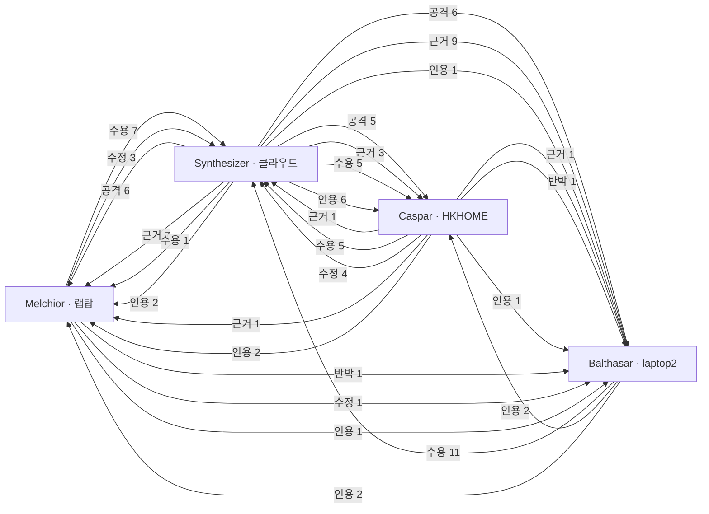

# MAGI-007 간선 전체 (160개 · 묶음 8)

봉인 묶음의 `edges.json` 을 그대로 옮긴 표. 종류 ∈ 공격 · 수용 · 수정 · 반박 · 인용 · 근거.

## 자리 사이 흐름 (자리 안 간선 제외)

## R1_laptop (13)

| from | 종류 | to | 메모 |
|---|---|---|---|
| [Melchior M-1 열린 자리 치환 넷은 통로 수를 바꾸지 않고(4 → 4) 전하를 끈 선택도 S_OFF 를 39 → 53~63 으로 올립니다 `［전문］`](../R1_laptop/note.md) | 근거 | [Melchior M-V 다섯 설계를 넘는 개질이 2주 안에 확인될 가능성은 낮고, 세 조건 전부에서 서는 후보는 −Br 이 될 것으로 봅니다(확신 중) `［가설］`](../R1_laptop/note.md) |  |
| [Melchior M-2 치환기는 카복실–Zn 줄 위의 통로 벽에 놓이고, CO₂ 는 c 축 1차원 통로에 모입니다 `［전문］`](../R1_laptop/note.md) | 근거 | [Melchior M-1 열린 자리 치환 넷은 통로 수를 바꾸지 않고(4 → 4) 전하를 끈 선택도 S_OFF 를 39 → 53~63 으로 올립니다 `［전문］`](../R1_laptop/note.md) |  |
| [Melchior M-3 전하 항의 몫 f 를 올린 치환기는 −CN 하나입니다(25.9 % 대 모체 22.6 %) `［전문］`](../R1_laptop/note.md) | 근거 | [Melchior M-4 −CN 만 작동점 선택도가 헨리 선택도보다 높습니다(비 1.21). 값은 `［전문］` 이고, CO₂ 끼리의 협동이라는 기제는 `［가설］` 입니다](../R1_laptop/note.md) |  |
| [Melchior M-5 RH90 CO₂–H₂O 이원 계산에서 다섯 설계의 CO₂ 습윤/건조 비는 0.96~1.00 입니다 `［전문］`](../R1_laptop/note.md) | 근거 | [Melchior M-6 그래서 E 에서는 S_humid 가 건조 S_mix 와 비슷하고(유지비 0.93~1.03), 이를 판별하는 관측은 −CN 의 유지비라고 봅니다 `［가설］`](../R1_laptop/note.md) |  |
| [Melchior M-7 UFF4MOF 상한 300 이완 뒤 −CN · −Cl 은 CO₂ 통로가 0 이고 AV 가 0.0 이지만, −Br 은 열려 있습니다 `［전문］`](../R1_laptop/note.md) | 근거 | [Melchior M-11 A 에서 −CN 은 막음 뒤 두 적재가 약 0 이 되어 S_mix 가 정의되지 않을 가능성이 크고, A 판정 표에는 이 경우를 담는 칸이 없습니다 `［가설］`](../R1_laptop/note.md) |  |
| [Melchior M-8 통로가 닫히는 까닭은 Zn–O 가 늘며 셀이 a 방향으로 커지고, 이때 링커가 16° 돌아 창을 조이기 때문입니다. 모체에서도 이 회전이 나타납니다 `［전문］`](../R1_laptop/note.md) | 인용 | [Melchior M-7 UFF4MOF 상한 300 이완 뒤 −CN · −Cl 은 CO₂ 통로가 0 이고 AV 가 0.0 이지만, −Br 은 열려 있습니다 `［전문］`](../R1_laptop/note.md) |  |
| [Melchior M-9 모체의 S_mix 323/298 비는 0.669 입니다 `［산술］`](../R1_laptop/note.md) | 근거 | [Melchior M-10 이 비에 맞춘 헨리 근사로 열린 자리 −CN · −Br 의 323/298 비를 0.60~0.66 으로 봅니다 `［산술］` · `［가설］`](../R1_laptop/note.md) |  |
| [Melchior M-3 전하 항의 몫 f 를 올린 치환기는 −CN 하나입니다(25.9 % 대 모체 22.6 %) `［전문］`](../R1_laptop/note.md) | 근거 | [Melchior M-C3 셋째 후보인 열린 자리 −NO₂ 는 전하 항 쪽의 상한을 시험합니다. 넘을 확률은 0.15 입니다 `［가설］`](../R1_laptop/note.md) |  |
| [Melchior M-3 전하 항의 몫 f 를 올린 치환기는 −CN 하나입니다(25.9 % 대 모체 22.6 %) `［전문］`](../R1_laptop/note.md) | 근거 | [Melchior M-C1 첫째 후보인 열린 자리 −C≡CH 는 CN 이득이 모양에서 오는지 극성에서 오는지를 구분합니다. CN 을 넘을 확률은 0.15 로 봅니다 `［가설］`](../R1_laptop/note.md) |  |
| [Melchior M-6 그래서 E 에서는 S_humid 가 건조 S_mix 와 비슷하고(유지비 0.93~1.03), 이를 판별하는 관측은 −CN 의 유지비라고 봅니다 `［가설］`](../R1_laptop/note.md) | 근거 | [Melchior M-V 다섯 설계를 넘는 개질이 2주 안에 확인될 가능성은 낮고, 세 조건 전부에서 서는 후보는 −Br 이 될 것으로 봅니다(확신 중) `［가설］`](../R1_laptop/note.md) |  |
| [Melchior M-11 A 에서 −CN 은 막음 뒤 두 적재가 약 0 이 되어 S_mix 가 정의되지 않을 가능성이 크고, A 판정 표에는 이 경우를 담는 칸이 없습니다 `［가설］`](../R1_laptop/note.md) | 근거 | [Melchior M-V 다섯 설계를 넘는 개질이 2주 안에 확인될 가능성은 낮고, 세 조건 전부에서 서는 후보는 −Br 이 될 것으로 봅니다(확신 중) `［가설］`](../R1_laptop/note.md) |  |
| [Melchior M-10 이 비에 맞춘 헨리 근사로 열린 자리 −CN · −Br 의 323/298 비를 0.60~0.66 으로 봅니다 `［산술］` · `［가설］`](../R1_laptop/note.md) | 근거 | [Melchior M-V 다섯 설계를 넘는 개질이 2주 안에 확인될 가능성은 낮고, 세 조건 전부에서 서는 후보는 −Br 이 될 것으로 봅니다(확신 중) `［가설］`](../R1_laptop/note.md) |  |
| [Melchior M-12 "−C₂H₅ 323 K 단독 선두(E-27b)" 의 92.99 는 전 치환 구조 `e24c_c2h5_100` 의 값이라 §25 로 보류된 수입니다. 열린 자리 −C₂H₅ 의 323 K 값은…](../R1_laptop/note.md) | 반박 | [Melchior M-V 다섯 설계를 넘는 개질이 2주 안에 확인될 가능성은 낮고, 세 조건 전부에서 서는 후보는 −Br 이 될 것으로 봅니다(확신 중) `［가설］`](../R1_laptop/note.md) | 브리핑 v3 §10 · cloud.md §5 의 −C₂H₅ 근거 하나에 대한 이의(결정 자체는 수용) |

## R1_laptop2 (20)

| from | 종류 | to | 메모 |
|---|---|---|---|
| [Balthasar B-1 이득의 출처](../R1_laptop2/note.md) | 근거 | [src:results_e24i_*_open_mix](../R1_laptop2/sources.md) | 열린 자리 다섯의 S_mix · 적재(원자료 재계산) |
| [Balthasar B-1 이득의 출처](../R1_laptop2/note.md) | 근거 | [src:results_e23_mix_desktop](../R1_laptop2/sources.md) | 모체 S_mix · 적재 |
| [Balthasar B-2 물(E)](../R1_laptop2/note.md) | 근거 | [src:humid_working_capacity_w2_e24i](../R1_laptop2/sources.md) | 습윤 이원 ads 의 물 · CO₂ 적재 |
| [Balthasar B-2 물(E)](../R1_laptop2/note.md) | 인용 | [Balthasar B-1 이득의 출처](../R1_laptop2/note.md) | N₂ 감소 기제가 물에도 남는다는 예측의 전제 |
| [Balthasar B-3 격자 이완(A)](../R1_laptop2/note.md) | 근거 | [src:results_e24i_relax300_laptop](../R1_laptop2/sources.md) | 이완본 통로 수 · 주머니 수 |
| [Balthasar B-3 격자 이완(A)](../R1_laptop2/note.md) | 인용 | [Balthasar B-1 이득의 출처](../R1_laptop2/note.md) | 통로 폭에 걸린 기제라 격자 이완에 민감 |
| [Balthasar B-4 323 K(B)](../R1_laptop2/note.md) | 근거 | [src:results_e27_mix323_laptop](../R1_laptop2/sources.md) | 모체 323 K / 298 K 비 |
| [Balthasar B-4 323 K(B)](../R1_laptop2/note.md) | 인용 | [Balthasar B-1 이득의 출처](../R1_laptop2/note.md) | 기하 기제면 온도는 비율만 낮춤 |
| [Balthasar B-5 후보 ① 열린 자리 4,8-(C≡CH)₂](../R1_laptop2/note.md) | 인용 | [Balthasar B-1 이득의 출처](../R1_laptop2/note.md) | −CN 의 CO₂ +15 % 출처를 구분하는 대조 |
| [Balthasar B-5 후보 ① 열린 자리 4,8-(C≡CH)₂](../R1_laptop2/note.md) | 근거 | [src:build_e24g_bdtdc](../R1_laptop2/sources.md) | SMILES 이미 있음 · 전 자리 치환 탈락 기록 |
| [Balthasar B-6 후보 ② bib 의 2-메틸이미다졸 판](../R1_laptop2/note.md) | 근거 | [src:build_e22_bdtdc](../R1_laptop2/sources.md) | 빌더는 6원 고리 C–H 만 찾음 → 확장 필요 |
| [Balthasar B-7 일정](../R1_laptop2/note.md) | 근거 | [src:MACHINE_CAPABILITIES](../R1_laptop2/sources.md) | rdkit · LAMMPS 는 랩탑 · HKHOME 만 |
| [Balthasar B-7 일정](../R1_laptop2/note.md) | 인용 | [Balthasar B-5 후보 ① 열린 자리 4,8-(C≡CH)₂](../R1_laptop2/note.md) | ① 일정 5~7일 |
| [Balthasar B-7 일정](../R1_laptop2/note.md) | 인용 | [Balthasar B-6 후보 ② bib 의 2-메틸이미다졸 판](../R1_laptop2/note.md) | ② 일정 7~10일 |
| [Balthasar B-8 포스터에 지금 쓸 수 있는 문장](../R1_laptop2/note.md) | 근거 | [src:FINAL_RANKING_SMIX_G](../R1_laptop2/sources.md) | 기준선 정본 |
| [Balthasar B-9 아직 쓸 수 없는 문장](../R1_laptop2/note.md) | 인용 | [Balthasar B-2 물(E)](../R1_laptop2/note.md) | E 3회 비교 기대 차 1.5 단위 근처 |
| [Balthasar B-9 아직 쓸 수 없는 문장](../R1_laptop2/note.md) | 인용 | [Balthasar B-3 격자 이완(A)](../R1_laptop2/note.md) | 이완본 −CN 통로 0 |
| [Balthasar B-9 아직 쓸 수 없는 문장](../R1_laptop2/note.md) | 근거 | [src:FINAL_RANKING_SMIX_G](../R1_laptop2/sources.md) | CoRE 기하 모체 113.7 대 이완 · PACMAN 모체 75.4 |
| [Balthasar B-10 dissent](../R1_laptop2/note.md) | 반박 | [src:ASSIGN_ZNBDT_SUPP_A_table](../R1_laptop2/sources.md) | 값이 정해지지 않는 경우의 칸이 표에 없음 |
| [Balthasar B-10 dissent](../R1_laptop2/note.md) | 인용 | [Balthasar B-3 격자 이완(A)](../R1_laptop2/note.md) | 통로 0 → 적재 0 근처 |

## R1_hkhome (9)

| from | 종류 | to | 메모 |
|---|---|---|---|
| [Caspar C-3 격자 이완(A)에서 치환기별로 갈린다](../R1_hkhome/note.md) | 근거 | [Caspar C-4 A 판정 표에는 0/0 을 담는 칸이 없다(등록 층)](../R1_hkhome/note.md) | 이완본 −CN 통로 0 이 판정 표의 0/0 빈칸을 만든다 |
| [Caspar C-1 습윤(E)에서 열린 자리 이득은 버틴다](../R1_hkhome/note.md) | 반박 | [Caspar C-13 자기 반박](../R1_hkhome/note.md) | 자기 반박 — 강체·UFF 물 과소 위의 판단 |
| [Caspar C-5 S_humid 에서 지금 다섯을 1.5 단위 넘게 이길 개질은 저장소 근거로 제시할 수 없다](../R1_hkhome/note.md) | 근거 | [Caspar C-6 후보① — 열린 자리 CN/Br 비대칭(4-CN-8-Br)](../R1_hkhome/note.md) | 이길 후보가 없으니 1위 후보 대신 기제 시험을 낸다 |
| [Caspar C-5 S_humid 에서 지금 다섯을 1.5 단위 넘게 이길 개질은 저장소 근거로 제시할 수 없다](../R1_hkhome/note.md) | 근거 | [Caspar C-7 점검⓪ — bib 원자가 CO₂ 통로 벽에 닿는가를 GCMC 없이 먼저 센다](../R1_hkhome/note.md) | bib 쪽 자료 0건 — 짓기 전에 센다 |
| [Caspar C-8 일정 — 열린 자리 bdtdc 치환은 2주 안에 2~3개까지 된다](../R1_hkhome/note.md) | 인용 | [Caspar C-6 후보① — 열린 자리 CN/Br 비대칭(4-CN-8-Br)](../R1_hkhome/note.md) | E-24i 실측 일정이 후보①의 2주 안 가능 판단의 근거 |
| [Caspar C-9 포스터에 열린 자리의 323 K 값은 아직 없다](../R1_hkhome/note.md) | 인용 | [Caspar C-2 323 K(B)에서 크기는 줄고 순서는 유지된다](../R1_hkhome/note.md) | 열린 자리 323 K 값은 B 전까지 모체뿐 |
| [Caspar C-10 mslm050 의 "39.7 과 같은 CIF" 는 한 파일로 정해지지 않는다](../R1_hkhome/note.md) | 인용 | [Caspar C-12 E-2 유지비의 분모 판본이 등록에 없다](../R1_hkhome/note.md) | 같은 판본 문제 — 분모가 등록에 안 정해짐 |
| [Caspar C-11 기준선 재계산 — 두 판본 모두 원자료에서 그대로 나오고, 차이는 씨앗 s4~s6 을 더한 것뿐이다](../R1_hkhome/note.md) | 근거 | [Caspar C-12 E-2 유지비의 분모 판본이 등록에 없다](../R1_hkhome/note.md) | 6씨앗 판과 3씨앗 판의 차를 원자료로 보임 |
| [Caspar C-3 격자 이완(A)에서 치환기별로 갈린다](../R1_hkhome/note.md) | 근거 | [Caspar C-9 포스터에 열린 자리의 323 K 값은 아직 없다](../R1_hkhome/note.md) | 격자 이완에도 1위 문장을 못 쓰는 이유 |

## R2_cloud (32)

| from | 종류 | to | 메모 |
|---|---|---|---|
| [A-1 종합자 오류가 먼저입니다. −C₂H₅ 를 E 에 넣자는 권고 근거로 "323 K 단독 선두(E-27b 92.99)" 를 적었는데, Melchior(§4 쓸 수 …](questions/A-1.md) | 반박 | [SYN-brief-§10-3](../../MAGI-007_brief.md) | 종합자 자백 — C₂H₅ 92.99 는 전 치환판 |
| [A-1 종합자 오류가 먼저입니다. −C₂H₅ 를 E 에 넣자는 권고 근거로 "323 K 단독 선두(E-27b 92.99)" 를 적었는데, Melchior(§4 쓸 수 …](questions/A-1.md) | 수용 | [Melchior M-dissent-1](../R1_laptop/note.md) | Melchior 지적이 맞음 |
| [A-1 종합자 오류가 먼저입니다. −C₂H₅ 를 E 에 넣자는 권고 근거로 "323 K 단독 선두(E-27b 92.99)" 를 적었는데, Melchior(§4 쓸 수 …](questions/A-1.md) | 수용 | [Caspar C-§4-3](../R1_hkhome/note.md) | Caspar 지적이 맞음 |
| [A-2 기제가 두 층에서 다르게 읽히는데, 세 R1 이 한 층만 봤습니다. 원자료(Widom ON · results_magi5_e3_e24i_*_open_widom_*…](questions/A-2.md) | 공격 | [Balthasar B-1 이득의 출처](../R1_laptop2/note.md) | 헨리 K_H(N₂) 불감 대 작동점 N₂ 감소 |
| [A-2 기제가 두 층에서 다르게 읽히는데, 세 R1 이 한 층만 봤습니다. 원자료(Widom ON · results_magi5_e3_e24i_*_open_widom_*…](questions/A-2.md) | 공격 | [Melchior M-1 열린 자리 치환 넷은 통로 수를 바꾸지 않고(4 → 4) 전하를 끈 선택도 S_OFF 를 39 → 53~63 으로 올립니다 `［전문］`](../R1_laptop/note.md) | 헨리 층 설명 — 작동점 경쟁과 구분 요구 |
| [A-2 기제가 두 층에서 다르게 읽히는데, 세 R1 이 한 층만 봤습니다. 원자료(Widom ON · results_magi5_e3_e24i_*_open_widom_*…](questions/A-2.md) | 공격 | [Melchior M-10 이 비에 맞춘 헨리 근사로 열린 자리 −CN · −Br 의 323/298 비를 0.60~0.66 으로 봅니다 `［산술］` · `［가설］`](../R1_laptop/note.md) | 헨리 ΔQ 근사가 작동점 경쟁에 서는가 |
| [A-2 기제가 두 층에서 다르게 읽히는데, 세 R1 이 한 층만 봤습니다. 원자료(Widom ON · results_magi5_e3_e24i_*_open_widom_*…](questions/A-2.md) | 공격 | [Caspar C-§1-②](../R1_hkhome/note.md) | 같은 질의 — 두 층 |
| [A-3 Caspar §4-6 재현. 23_SCREENING/final_ranking_smix.py 60행과 final_ranking.py 66행은 results_mag…](questions/A-3.md) | 수용 | [Caspar C-§4-6](../R1_hkhome/note.md) | 코드에서 재현 — 차단 없는 154.3 |
| [A-3 Caspar §4-6 재현. 23_SCREENING/final_ranking_smix.py 60행과 final_ranking.py 66행은 results_mag…](questions/A-3.md) | 반박 | [FINAL_RANKING-§A′-1](../../../../23_SCREENING/FINAL_RANKING_20260930.md) | C₂H₅ 헨리 1위 무효 |
| [A-4 Caspar §4-7 재현. risk_screen.py 414~421행: 'PLD': (m0［'PLD'］ …) > CO2_KINETIC · 'AV': (m0.g…](questions/A-4.md) | 수용 | [Caspar C-§4-7](../R1_hkhome/note.md) | risk_screen.py m0 재현 |
| [A-5 둘 다 재현. ① ours_extra_20260930.json 은 CN "141.5 ± 5.5" · Br "128.0 ± 5.1" 을 손으로 적은 문자열(3씨앗…](questions/A-5.md) | 수용 | [Caspar C-dissent-③](../R1_hkhome/note.md) | mslm050 상수 n_seed=6 |
| [A-5 둘 다 재현. ① ours_extra_20260930.json 은 CN "141.5 ± 5.5" · Br "128.0 ± 5.1" 을 손으로 적은 문자열(3씨앗…](questions/A-5.md) | 수용 | [Caspar C-dissent-⑦](../R1_hkhome/note.md) | ours_extra 손입력 |
| [A-6 A 는 21:2x 사용자 결정으로 측정 사실로 닫혔습니다(ASSIGN 종합자 확정 5: 이완본 −CN · −Br 모두 N₂ 통로 0 → S_mix 정의 안 됨 …](questions/A-6.md) | 공격 | [Melchior M-§1-2](../R1_laptop/note.md) | A 닫힘 — 채점 불가 · 재진술 |
| [A-6 A 는 21:2x 사용자 결정으로 측정 사실로 닫혔습니다(ASSIGN 종합자 확정 5: 이완본 −CN · −Br 모두 N₂ 통로 0 → S_mix 정의 안 됨 …](questions/A-6.md) | 공격 | [Caspar C-§5-1-A](../R1_hkhome/note.md) | 같음 |
| [A-6 A 는 21:2x 사용자 결정으로 측정 사실로 닫혔습니다(ASSIGN 종합자 확정 5: 이완본 −CN · −Br 모두 N₂ 통로 0 → S_mix 정의 안 됨 …](questions/A-6.md) | 공격 | [Balthasar B-3 격자 이완(A)](../R1_laptop2/note.md) | 같음 |
| [A-7 세 자리가 모두 CO₂–H₂O 이원(N₂ 없음) 결과를 3성분으로 옮겼고, 셋 다 그 약점을 스스로 적었습니다(M §6: "N₂ 가 끼면 S_humid 가 오히…](questions/A-7.md) | 인용 | [Melchior M-§1-1](../R1_laptop/note.md) | 유지비 > 1 기각 조건을 적은 유일한 자리 |
| [A-7 세 자리가 모두 CO₂–H₂O 이원(N₂ 없음) 결과를 3성분으로 옮겼고, 셋 다 그 약점을 스스로 적었습니다(M §6: "N₂ 가 끼면 S_humid 가 오히…](questions/A-7.md) | 공격 | [Caspar C-§1-E](../R1_hkhome/note.md) | 위쪽 기각 조건 없음 |
| [A-7 세 자리가 모두 CO₂–H₂O 이원(N₂ 없음) 결과를 3성분으로 옮겼고, 셋 다 그 약점을 스스로 적었습니다(M §6: "N₂ 가 끼면 S_humid 가 오히…](questions/A-7.md) | 공격 | [Balthasar B-2 물(E)](../R1_laptop2/note.md) | 위쪽 기각 조건 없음 |
| [A-8 ΔQ 12.86 kJ/mol 과 비 0.645 · 0.635 는 재현됩니다. 그러나 "치환이 N₂ 쪽 흡착열을 바꾸지 않는다" 는 가정이 아니어도 됩니다 — 같…](questions/A-8.md) | 공격 | [Melchior M-10 이 비에 맞춘 헨리 근사로 열린 자리 −CN · −Br 의 323/298 비를 0.60~0.66 으로 봅니다 `［산술］` · `［가설］`](../R1_laptop/note.md) | ΔU(N₂) 원자료로 |
| [A-9 각주가 밝힌 대로 수치 셋이 바뀌었습니다(12.87 → 12.85 · 0.644 → 0.645 · 0.634 → 0.635). 범위 · 결론 불변이고 두 판 모…](questions/A-9.md) | 공격 | [Melchior M-머리말](../R1_laptop/note.md) | 수치 셋 변경 대 '불변' |
| [A-10 −NO₂ 열린 자리는 전 치환판에서 S_ON 을 보존했고(E-22b: 87.8 → 88.9, 정전기 몫을 바닥으로 옮김) 물 지수를 10배 올렸습니다(E-22c…](questions/A-10.md) | 공격 | [Melchior M-C3 셋째 후보인 열린 자리 −NO₂ 는 전하 항 쪽의 상한을 시험합니다. 넘을 확률은 0.15 입니다 `［가설］`](../R1_laptop/note.md) | NO₂ 전 치환 보존 · 물 10배 |
| [A-11 기록(비난 아님). 자백대로 4c64fb91 은 봉인 근거의 결과 일부를 공개 전에 냈습니다. 다른 두 R1 에 그 수가 없어 오염 흔적은 없고, E 실행 CI…](questions/A-11.md) | 인용 | [Caspar C-§6-0](../R1_hkhome/note.md) | 선공개 기록 |
| [A-12 build_e24i_bdtdc.py 의 sites() 결과는 자리마다 ring 번호만 갖고 4-자리와 8-자리를 가르는 속성이 없습니다(종합자가 파일을 읽음 —…](questions/A-12.md) | 공격 | [Caspar C-후보①](../R1_hkhome/note.md) | sites() 에 4/8 속성 없음 |
| [A-13 세는 양이 정의되지 않았습니다: 어느 격자(건조 ON? 습윤?) · 어느 등가면(밀도 상위 몇 %) · "접촉" 의 거리 문턱 · bib 의 어느 원자(이미다졸…](questions/A-13.md) | 공격 | [Caspar C-점검⓪](../R1_hkhome/note.md) | 양 · 문턱 미정의 |
| [A-14 A-2 의 본론입니다. 적재 표는 전부 재현되지만, 헨리 K_H(N₂)는 치환체에서 줄지 않았습니다(−1.7 ~ +16.6 %). N₂ 가 앉을 자리가 줄었다면…](questions/A-14.md) | 공격 | [Balthasar B-1 이득의 출처](../R1_laptop2/note.md) | A-2 본론 |
| [A-15 (질의 없음 — 재현) — 회차 상대 ± 평균(CN 7.0 % · Br 5.6 %)에서 3씨앗 자로 낸 기대 차 1.69 단위는 종합자 재계산(1.72)과 같습…](questions/A-15.md) | 근거 | [Balthasar B-2 물(E)](../R1_laptop2/note.md) | 재현 — 1.69 ≈ 1.72 |
| [A-16 전제가 바뀌었습니다: A 가 닫혀 HKHOME 이 지금부터 빕니다(21:2x). E 는 laptop2 15작업 완주(20:34) · 랩탑 6작업(mslm050 …](questions/A-16.md) | 공격 | [Balthasar B-7 일정](../R1_laptop2/note.md) | A 닫힘 전제로 재산정 |
| [A-17 ［미확인］ 둘(리간드 합성 · MOF 선례)이 후보② 의 "링커 합성이 가장 쉽다" 는 장점을 받칩니다. R3 에서 한 번 검색(CSD · 문헌)해 1,4-비스…](questions/A-17.md) | 공격 | [Balthasar B-6 후보 ② bib 의 2-메틸이미다졸 판](../R1_laptop2/note.md) | [미확인] 둘 |
| [SYN-sealed](../../MAGI-007_sealed_prediction_cloud.md) | 인용 | [Melchior M-C2 둘째 후보인 열린 자리 −CN/−Br 이종 한 쌍은 두 끝의 가산성을 시험합니다. 넘을 확률은 0.05 입니다 `［가설］`](../R1_laptop/note.md) | 같은 방향(혼합 CN/Br) |
| [SYN-sealed](../../MAGI-007_sealed_prediction_cloud.md) | 인용 | [Caspar C-후보①](../R1_hkhome/note.md) | 같은 방향(혼합 CN/Br) |
| [SYN-sealed](../../MAGI-007_sealed_prediction_cloud.md) | 인용 | [Balthasar B-6 후보 ② bib 의 2-메틸이미다졸 판](../R1_laptop2/note.md) | 같은 방향(bib 2-Me) |
| [Melchior M-C1 첫째 후보인 열린 자리 −C≡CH 는 CN 이득이 모양에서 오는지 극성에서 오는지를 구분합니다. CN 을 넘을 확률은 0.15 로 봅니다 `［가설］`](../R1_laptop/note.md) | 인용 | [Balthasar B-5 후보 ① 열린 자리 4,8-(C≡CH)₂](../R1_laptop2/note.md) | 독립 수렴 — 열린 자리 −C≡CH |

## R3_laptop (12)

| from | 종류 | to | 메모 |
|---|---|---|---|
| [Melchior D-1 ← A-1 (수용)](../R3_laptop/note.md) | 수용 | [A-1 종합자 오류가 먼저입니다. −C₂H₅ 를 E 에 넣자는 권고 근거로 "323 K 단독 선두(E-27b 92.99)" 를 적었는데, Melchior(§4 쓸 수 …](questions/A-1.md) |  |
| [Melchior D-2 ← A-2 (수정)](../R3_laptop/note.md) | 수정 | [A-2 기제가 두 층에서 다르게 읽히는데, 세 R1 이 한 층만 봤습니다. 원자료(Widom ON · results_magi5_e3_e24i_*_open_widom_*…](questions/A-2.md) |  |
| [Melchior D-2 ← A-2 (수정)](../R3_laptop/note.md) | 반박 | [Balthasar B-1 이득의 출처](../R1_laptop2/note.md) | K_H(N2) 증가 → 자리 감소보다 경쟁 |
| [Melchior D-3 ← A-3 (수용)](../R3_laptop/note.md) | 수용 | [A-3 Caspar §4-6 재현. 23_SCREENING/final_ranking_smix.py 60행과 final_ranking.py 66행은 results_mag…](questions/A-3.md) |  |
| [Melchior D-4 ← A-4 (수용)](../R3_laptop/note.md) | 수용 | [A-4 Caspar §4-7 재현. risk_screen.py 414~421행: 'PLD': (m0［'PLD'］ …) > CO2_KINETIC · 'AV': (m0.g…](questions/A-4.md) |  |
| [Melchior D-5 ← A-6 (수용)](../R3_laptop/note.md) | 수용 | [A-6 A 는 21:2x 사용자 결정으로 측정 사실로 닫혔습니다(ASSIGN 종합자 확정 5: 이완본 −CN · −Br 모두 N₂ 통로 0 → S_mix 정의 안 됨 …](questions/A-6.md) |  |
| [Melchior D-6 ← A-7 (수용)](../R3_laptop/note.md) | 수용 | [A-7 세 자리가 모두 CO₂–H₂O 이원(N₂ 없음) 결과를 3성분으로 옮겼고, 셋 다 그 약점을 스스로 적었습니다(M §6: "N₂ 가 끼면 S_humid 가 오히…](questions/A-7.md) |  |
| [Melchior D-8 ← A-8 (수정)](../R3_laptop/note.md) | 수정 | [A-8 ΔQ 12.86 kJ/mol 과 비 0.645 · 0.635 는 재현됩니다. 그러나 "치환이 N₂ 쪽 흡착열을 바꾸지 않는다" 는 가정이 아니어도 됩니다 — 같…](questions/A-8.md) |  |
| [Melchior D-9 ← A-9 (수정)](../R3_laptop/note.md) | 수정 | [A-9 각주가 밝힌 대로 수치 셋이 바뀌었습니다(12.87 → 12.85 · 0.644 → 0.645 · 0.634 → 0.635). 범위 · 결론 불변이고 두 판 모…](questions/A-9.md) |  |
| [Melchior D-10 ← A-10 (수용)](../R3_laptop/note.md) | 수용 | [A-10 −NO₂ 열린 자리는 전 치환판에서 S_ON 을 보존했고(E-22b: 87.8 → 88.9, 정전기 몫을 바닥으로 옮김) 물 지수를 10배 올렸습니다(E-22c…](questions/A-10.md) |  |
| [R3 §3 (Melchior)](../../MAGI-007_R3_laptop.md) | 수용 | [A-12 build_e24i_bdtdc.py 의 sites() 결과는 자리마다 ring 번호만 갖고 4-자리와 8-자리를 가르는 속성이 없습니다(종합자가 파일을 읽음 —…](questions/A-12.md) |  |
| [R3 §3 (Melchior)](../../MAGI-007_R3_laptop.md) | 수정 | [Balthasar B-6 후보 ② bib 의 2-메틸이미다졸 판](../R1_laptop2/note.md) | 지을 수 있음 + 격자 고정 상한 단서 |

## R3_laptop2 (26)

| from | 종류 | to | 메모 |
|---|---|---|---|
| [Balthasar D-1 수용](../R3_laptop2/note.md) | 수용 | [A-1 종합자 오류가 먼저입니다. −C₂H₅ 를 E 에 넣자는 권고 근거로 "323 K 단독 선두(E-27b 92.99)" 를 적었는데, Melchior(§4 쓸 수 …](questions/A-1.md) | 92.99 를 쓰지 않았음 · 정정에 이견 없음 |
| [Balthasar D-2 수정](../R3_laptop2/note.md) | 수용 | [A-2 기제가 두 층에서 다르게 읽히는데, 세 R1 이 한 층만 봤습니다. 원자료(Widom ON · results_magi5_e3_e24i_*_open_widom_*…](questions/A-2.md) | 두 층 구분을 받아 원자료로 나눔(수정) |
| [Balthasar D-2 수정](../R3_laptop2/note.md) | 반박 | [Balthasar B-1 이득의 출처](../R1_laptop2/note.md) | N₂ 감소의 97~132 % 가 작동점 층 — 헨리 층 자리 감소 아님 |
| [Balthasar D-2 수정](../R3_laptop2/note.md) | 인용 | [Melchior M-10 이 비에 맞춘 헨리 근사로 열린 자리 −CN · −Br 의 323/298 비를 0.60~0.66 으로 봅니다 `［산술］` · `［가설］`](../R1_laptop/note.md) | 헨리 ΔQ 근사는 S 이득의 헨리 층 몫(46~104 %)에만 섬 |
| [Balthasar D-2 수정](../R3_laptop2/note.md) | 인용 | [Caspar C-§1-③](../R1_hkhome/note.md) | 작동점 비 S_mix/S_Henry 1.21 과 같은 양 — r_CO₂/r_N₂ |
| [Balthasar D-2 수정](../R3_laptop2/note.md) | 반박 | [Balthasar B-4 323 K(B)](../R1_laptop2/note.md) | B 예측이 틀릴 길 — 작동점 층의 온도 민감도(수치는 그대로) |
| [Balthasar D-2 수정](../R3_laptop2/note.md) | 근거 | [src:results_magi5_e3_e24i_widom](../R3_laptop2/sources.md) | Widom ON K_H(CO₂) · K_H(N₂) |
| [Balthasar D-2 수정](../R3_laptop2/note.md) | 근거 | [src:R1_laptop2_evidence.json](../R3_laptop2/sources.md) | 작동점 적재(원자료 재계산값) |
| [Balthasar D-3 수용](../R3_laptop2/note.md) | 수용 | [A-3 Caspar §4-6 재현. 23_SCREENING/final_ranking_smix.py 60행과 final_ranking.py 66행은 results_mag…](questions/A-3.md) | R1 에 154.3 · 헨리 1위 없음 |
| [Balthasar D-4 수용](../R3_laptop2/note.md) | 수용 | [A-4 Caspar §4-7 재현. risk_screen.py 414~421행: 'PLD': (m0［'PLD'］ …) > CO2_KINETIC · 'AV': (m0.g…](questions/A-4.md) | N₂ 탐침 통로 수 열 추가 제안 |
| [Balthasar D-5 수용](../R3_laptop2/note.md) | 수용 | [A-5 둘 다 재현. ① ours_extra_20260930.json 은 CN "141.5 ± 5.5" · Br "128.0 ± 5.1" 을 손으로 적은 문자열(3씨앗…](questions/A-5.md) | 기록에 동의 |
| [Balthasar D-6 수용](../R3_laptop2/note.md) | 수용 | [A-6 A 는 21:2x 사용자 결정으로 측정 사실로 닫혔습니다(ASSIGN 종합자 확정 5: 이완본 −CN · −Br 모두 N₂ 통로 0 → S_mix 정의 안 됨 …](questions/A-6.md) | A 예측 채점 불가 · B-10 dissent 거둠 |
| [Balthasar D-6 수용](../R3_laptop2/note.md) | 반박 | [Balthasar B-3 격자 이완(A)](../R1_laptop2/note.md) | 자기 기록 — −Br 의 N₂ 통로 0 을 놓침 |
| [Balthasar D-7 수용](../R3_laptop2/note.md) | 수용 | [A-7 세 자리가 모두 CO₂–H₂O 이원(N₂ 없음) 결과를 3성분으로 옮겼고, 셋 다 그 약점을 스스로 적었습니다(M §6: "N₂ 가 끼면 S_humid 가 오히…](questions/A-7.md) | 상한 위로 나오면 물이 N₂ 빈자리를 나눠 쓴 것 |
| [Balthasar D-7 수용](../R3_laptop2/note.md) | 근거 | [src:results_znbdt_e_humid3_laptop2](../R3_laptop2/sources.md) | [E 결과 인용] 유지비 0.995~1.034 · N₂ 비 0.971~1.001 |
| [Balthasar D-14 수정](../R3_laptop2/note.md) | 수용 | [A-14 A-2 의 본론입니다. 적재 표는 전부 재현되지만, 헨리 K_H(N₂)는 치환체에서 줄지 않았습니다(−1.7 ~ +16.6 %). N₂ 가 앉을 자리가 줄었다면…](questions/A-14.md) | B-1 해석 수정 — 자리 감소 철회 |
| [Balthasar D-14 수정](../R3_laptop2/note.md) | 반박 | [Balthasar B-1 이득의 출처](../R1_laptop2/note.md) | 'N₂ 가 앉을 자리를 줄였다' 철회 · 바꾼 문장 |
| [Balthasar D-14 수정](../R3_laptop2/note.md) | 근거 | [src:results_e24i_blockpockets_hkhome](../R3_laptop2/sources.md) | 자리 감소의 모양 — 막음 −C₂H₅ K_H(N₂) 0.62배 |
| [Balthasar D-15 수용](../R3_laptop2/note.md) | 수용 | [A-15 (질의 없음 — 재현) — 회차 상대 ± 평균(CN 7.0 % · Br 5.6 %)에서 3씨앗 자로 낸 기대 차 1.69 단위는 종합자 재계산(1.72)과 같습…](questions/A-15.md) | 1.69 와 1.72 는 같은 산술 |
| [Balthasar D-16 수정](../R3_laptop2/note.md) | 수용 | [A-16 전제가 바뀌었습니다: A 가 닫혀 HKHOME 이 지금부터 빕니다(21:2x). E 는 laptop2 15작업 완주(20:34) · 랩탑 6작업(mslm050 …](questions/A-16.md) | 일정 다시 냄 — ① 2~3일 · ② 3~5일(수정) |
| [Balthasar D-16 수정](../R3_laptop2/note.md) | 반박 | [Balthasar B-7 일정](../R1_laptop2/note.md) | 기기 제약이 HKHOME 한 기기로 바뀜 |
| [Balthasar D-16 수정](../R3_laptop2/note.md) | 인용 | [Caspar C-§2-점검⓪](../R1_hkhome/note.md) | ② 의 선행 조건 |
| [Balthasar D-17 수정](../R3_laptop2/note.md) | 수용 | [A-17 ［미확인］ 둘(리간드 합성 · MOF 선례)이 후보② 의 "링커 합성이 가장 쉽다" 는 장점을 받칩니다. R3 에서 한 번 검색(CSD · 문헌)해 1,4-비스…](questions/A-17.md) | 문헌 검색 한 번 — 등급 올림(수정) |
| [Balthasar D-17 수정](../R3_laptop2/note.md) | 반박 | [Balthasar B-6 후보 ② bib 의 2-메틸이미다졸 판](../R1_laptop2/note.md) | '합성이 가장 쉽다' 를 리간드 단계로 좁힘 |
| [Balthasar D-17 수정](../R3_laptop2/note.md) | 인용 | [Melchior M-§2](../R1_laptop/note.md) | '잴 수 없다' 의 세 이유 — 층이 달라 함께 섬 |
| [Balthasar D-17 수정](../R3_laptop2/note.md) | 근거 | [src:Zhao2013_ICA_402_25](../R3_laptop2/sources.md) | 같은 리간드의 Zn(II) 배위고분자 · COD 1517041 |

## R3_hkhome (16)

| from | 종류 | to | 메모 |
|---|---|---|---|
| [Caspar D-1 (수용)](../R3_hkhome/note.md) | 수용 | [A-1 종합자 오류가 먼저입니다. −C₂H₅ 를 E 에 넣자는 권고 근거로 "323 K 단독 선두(E-27b 92.99)" 를 적었는데, Melchior(§4 쓸 수 …](questions/A-1.md) | 종합자 정정(323 K 92.99 는 4,8-전 치환값)은 R1 §4-3 과 같다. 권고는 이 수 없이 선다. |
| [Caspar D-2 (수정)](../R3_hkhome/note.md) | 수정 | [A-2 기제가 두 층에서 다르게 읽히는데, 세 R1 이 한 층만 봤습니다. 원자료(Widom ON · results_magi5_e3_e24i_*_open_widom_*…](questions/A-2.md) | B 자료로 두 층을 가른다: 모체 N_N₂ 는 298→323 K ×1.00, −CN ×1.24 · −Br ×1.19. 모체 대비 결손 −38→− |
| [Caspar D-3 (수용)](../R3_hkhome/note.md) | 수용 | [A-3 Caspar §4-6 재현. 23_SCREENING/final_ranking_smix.py 60행과 final_ranking.py 66행은 results_mag…](questions/A-3.md) | −C₂H₅ 막음값 조인은 코드 쪽에서 — 막지 않은 154.34 는 표지 붙은 별도 열. |
| [Caspar D-4 (수용)](../R3_hkhome/note.md) | 수용 | [A-4 Caspar §4-7 재현. risk_screen.py 414~421행: 'PLD': (m0［'PLD'］ …) > CO2_KINETIC · 'AV': (m0.g…](questions/A-4.md) | 관문 ⑤ 서술 열에 통로 수를 두 탐침(1.65 · 1.82 Å) 모두 — 이완본 −Br 은 1.65 Å 통로 16 · 1.82 Å 통로 0. |
| [Caspar D-6 (수용)](../R3_hkhome/note.md) | 수용 | [A-6 A 는 21:2x 사용자 결정으로 측정 사실로 닫혔습니다(ASSIGN 종합자 확정 5: 이완본 −CN · −Br 모두 N₂ 통로 0 → S_mix 정의 안 됨 …](questions/A-6.md) | A 채점 불가 동의. 자기 기록: R1 의 −Br 'S_mix 정의됨' 은 측정과 반대 — CO₂ 탐침만 봄. ‡ 각주를 §P-1 '기공 지름 |
| [Caspar D-7 (수정)](../R3_hkhome/note.md) | 수정 | [A-7 세 자리가 모두 CO₂–H₂O 이원(N₂ 없음) 결과를 3성분으로 옮겼고, 셋 다 그 약점을 스스로 적었습니다(M §6: "N₂ 가 끼면 S_humid 가 오히…](questions/A-7.md) | 유지비 > 1.08 이면 틀린 것은 '물은 CO₂ 자리만 다툼' — 판별: N_N₂ 습윤/건조 < 0.966(분압비) − 1.5 단위 · N_C |
| [Caspar D-11 (수용)](../R3_hkhome/note.md) | 수용 | [A-11 기록(비난 아님). 자백대로 4c64fb91 은 봉인 근거의 결과 일부를 공개 전에 냈습니다. 다른 두 R1 에 그 수가 없어 오염 흔적은 없고, E 실행 CI…](questions/A-11.md) | 운영 보고가 봉인 근거와 겹치면 수 없이 결정만 올린다. |
| [Caspar D-12 (수정)](../R3_hkhome/note.md) | 수정 | [A-12 build_e24i_bdtdc.py 의 sites() 결과는 자리마다 ring 번호만 갖고 4-자리와 8-자리를 가르는 속성이 없습니다(종합자가 파일을 읽음 —…](questions/A-12.md) | 열린 고리의 두 H 는 반전으로 같은 자리(중점−고리 중심 0.000 Å · H···O 4.101 둘 다) — 이름표는 분수 z 로 정함. 4- |
| [Caspar D-13 (수정)](../R3_hkhome/note.md) | 수정 | [A-13 세는 양이 정의되지 않았습니다: 어느 격자(건조 ON? 습윤?) · 어느 등가면(밀도 상위 몇 %) · "접촉" 의 거리 문턱 · bib 의 어느 원자(이미다졸…](questions/A-13.md) | 점검⓪ 정의: 모체 CO₂ 밀도 격자 상위 5 % 복셀 · 4.0 Å 접촉 · f_bib 대 f₀. f_bib ≥ f₀ → bib 2-Me 빌더 |
| [Caspar D-2 (수정)](../R3_hkhome/note.md) | 반박 | [Balthasar B-1 이득의 출처](../R1_laptop2/note.md) | 작동점 N₂ 결손이 323 K 에서 줄어듦 — 자리 감소 단독은 안 섬 |
| [Caspar D-2 (수정)](../R3_hkhome/note.md) | 근거 | [A-14 A-2 의 본론입니다. 적재 표는 전부 재현되지만, 헨리 K_H(N₂)는 치환체에서 줄지 않았습니다(−1.7 ~ +16.6 %). N₂ 가 앉을 자리가 줄었다면…](questions/A-14.md) | A-14 의 경쟁 해석을 B 자료로 보강 |
| [Caspar D-2 (수정)](../R3_hkhome/note.md) | 인용 | [Melchior M-10 이 비에 맞춘 헨리 근사로 열린 자리 −CN · −Br 의 323/298 비를 0.60~0.66 으로 봅니다 `［산술］` · `［가설］`](../R1_laptop/note.md) | 헨리 ΔQ 에 포화 · 경쟁 몫의 온도 의존이 더 붙음 |
| [Caspar D-12 (수정)](../R3_hkhome/note.md) | 인용 | [Melchior M-C2 둘째 후보인 열린 자리 −CN/−Br 이종 한 쌍은 두 끝의 가산성을 시험합니다. 넘을 확률은 0.05 입니다 `［가설］`](../R1_laptop/note.md) | 링커별 CN₂/Br₂ 와 같은 링커 4/8 은 다른 구조 |
| [Caspar D-12 (수정)](../R3_hkhome/note.md) | 근거 | [Melchior M-C1 첫째 후보인 열린 자리 −C≡CH 는 CN 이득이 모양에서 오는지 극성에서 오는지를 구분합니다. CN 을 넘을 확률은 0.15 로 봅니다 `［가설］`](../R1_laptop/note.md) | 다음 빌드를 −C≡CH 로 — 배열 하나 · 빌더 범위 안 |
| [Caspar D-12 (수정)](../R3_hkhome/note.md) | 근거 | [Balthasar B-5 후보 ① 열린 자리 4,8-(C≡CH)₂](../R1_laptop2/note.md) | 같은 후보의 독립 수렴 |
| [Caspar D-13 (수정)](../R3_hkhome/note.md) | 인용 | [Balthasar B-6 후보 ② bib 의 2-메틸이미다졸 판](../R1_laptop2/note.md) | 점검⓪ 이 bib 2-Me 빌더 착수를 가름 |

## R4_cloud (32)

| from | 종류 | to | 메모 |
|---|---|---|---|
| [S-1 열린 자리 치환의 이득은 두 층이고, R1 셋은 한 층만 적었습니다.](consensus/S-1.md) | 근거 | [Melchior R3 §0](../../MAGI-007_R3_laptop.md) | ΔQ(N₂) 재계산 — 헨리 층 |
| [S-1 열린 자리 치환의 이득은 두 층이고, R1 셋은 한 층만 적었습니다.](consensus/S-1.md) | 근거 | [Melchior D-2 ← A-2 (수정)](../R3_laptop/note.md) | 두 층으로 수정 |
| [S-1 열린 자리 치환의 이득은 두 층이고, R1 셋은 한 층만 적었습니다.](consensus/S-1.md) | 근거 | [Balthasar D-2 수정](../R3_laptop2/note.md) | 잔류비 · 추가 배제비 |
| [S-1 열린 자리 치환의 이득은 두 층이고, R1 셋은 한 층만 적었습니다.](consensus/S-1.md) | 근거 | [Balthasar D-14 수정](../R3_laptop2/note.md) | B-1 철회 |
| [S-1 열린 자리 치환의 이득은 두 층이고, R1 셋은 한 층만 적었습니다.](consensus/S-1.md) | 인용 | [Caspar C-§1-③](../R1_hkhome/note.md) | 작동점 비 1.21 |
| [S-1 열린 자리 치환의 이득은 두 층이고, R1 셋은 한 층만 적었습니다.](consensus/S-1.md) | 인용 | [A-2 기제가 두 층에서 다르게 읽히는데, 세 R1 이 한 층만 봤습니다. 원자료(Widom ON · results_magi5_e3_e24i_*_open_widom_*…](questions/A-2.md) | 종합자 질의가 연 것 |
| [S-2 E(습윤 3성분): 이 모델에서 물은 CO₂ 와도 N₂ 와도 자리를 다투지 않습니다 — 세 R1 예측 일치, E 결과가 확인](consensus/S-2.md) | 근거 | [Melchior M-§1-1](../R1_laptop/note.md) | E 버팀 |
| [S-2 E(습윤 3성분): 이 모델에서 물은 CO₂ 와도 N₂ 와도 자리를 다투지 않습니다 — 세 R1 예측 일치, E 결과가 확인](consensus/S-2.md) | 근거 | [Balthasar D-7 수용](../R3_laptop2/note.md) | [E 결과 인용] N₂ 분압비 |
| [S-2 E(습윤 3성분): 이 모델에서 물은 CO₂ 와도 N₂ 와도 자리를 다투지 않습니다 — 세 R1 예측 일치, E 결과가 확인](consensus/S-2.md) | 근거 | [Caspar C-§1-E](../R1_hkhome/note.md) | E 행 |
| [S-2 E(습윤 3성분): 이 모델에서 물은 CO₂ 와도 N₂ 와도 자리를 다투지 않습니다 — 세 R1 예측 일치, E 결과가 확인](consensus/S-2.md) | 인용 | [Caspar C-§6-급소](../R1_hkhome/note.md) | E 가 재는 것의 한계 |
| [S-3 A(격자 이완): 측정 사실로 닫힘](consensus/S-3.md) | 근거 | [USER-21:2x-(가) 사용자 결정 11-04 21:2x — A(격자 이완)를 측정 사실로 닫음 · PACMAN 순전하 |q| ≤…](decisions.md) | A 측정 사실로 닫음 |
| [S-3 A(격자 이완): 측정 사실로 닫힘](consensus/S-3.md) | 인용 | [A-6 A 는 21:2x 사용자 결정으로 측정 사실로 닫혔습니다(ASSIGN 종합자 확정 5: 이완본 −CN · −Br 모두 N₂ 통로 0 → S_mix 정의 안 됨 …](questions/A-6.md) | 재진술 · 채점 불가 |
| [S-4 B(323 K): 순서 유지 · 크기는 약 0.6배 — 세 R1 방향 일치, 크기는 셋 다 조금 높게 봤습니다](consensus/S-4.md) | 근거 | [Melchior D-2 ← A-2 (수정)](../R3_laptop/note.md) | 헨리 한계 0.478 대 실측 0.591 |
| [S-4 B(323 K): 순서 유지 · 크기는 약 0.6배 — 세 R1 방향 일치, 크기는 셋 다 조금 높게 봤습니다](consensus/S-4.md) | 근거 | [E6-2-B (R4 §6-2 B 등록 읽기)](../../MAGI-007_ligand-modification.md) | B 등록 읽기 |
| [S-5 Q2: 지금 다섯 설계를 주 축(S_humid)에서 1.5 단위 넘게 이길 개질은 저장소 근거로 제시된 것이 없습니다 — 세 자리 일치](consensus/S-5.md) | 근거 | [Melchior M-C1 첫째 후보인 열린 자리 −C≡CH 는 CN 이득이 모양에서 오는지 극성에서 오는지를 구분합니다. CN 을 넘을 확률은 0.15 로 봅니다 `［가설］`](../R1_laptop/note.md) | −C≡CH |
| [S-5 Q2: 지금 다섯 설계를 주 축(S_humid)에서 1.5 단위 넘게 이길 개질은 저장소 근거로 제시된 것이 없습니다 — 세 자리 일치](consensus/S-5.md) | 근거 | [Balthasar B-5 후보 ① 열린 자리 4,8-(C≡CH)₂](../R1_laptop2/note.md) | −C≡CH 독립 |
| [S-5 Q2: 지금 다섯 설계를 주 축(S_humid)에서 1.5 단위 넘게 이길 개질은 저장소 근거로 제시된 것이 없습니다 — 세 자리 일치](consensus/S-5.md) | 근거 | [Balthasar D-17 수정](../R3_laptop2/note.md) | bib 층 맞추기 · 문헌 |
| [S-5 Q2: 지금 다섯 설계를 주 축(S_humid)에서 1.5 단위 넘게 이길 개질은 저장소 근거로 제시된 것이 없습니다 — 세 자리 일치](consensus/S-5.md) | 근거 | [Melchior R3 §3](../../MAGI-007_R3_laptop.md) | bib 함께 성립 |
| [S-5 Q2: 지금 다섯 설계를 주 축(S_humid)에서 1.5 단위 넘게 이길 개질은 저장소 근거로 제시된 것이 없습니다 — 세 자리 일치](consensus/S-5.md) | 인용 | [Caspar C-후보①](../R1_hkhome/note.md) | 정의 미완 — 후순위 |
| [S-5 Q2: 지금 다섯 설계를 주 축(S_humid)에서 1.5 단위 넘게 이길 개질은 저장소 근거로 제시된 것이 없습니다 — 세 자리 일치](consensus/S-5.md) | 인용 | [Caspar C-점검⓪](../R1_hkhome/note.md) | 정의 요청 |
| [S-6 Q3: HKHOME 이 비었으므로(A 닫힘) −C≡CH 는 착수 뒤 2~3일, bib 판은 점검⓪ 통과 뒤 3~5일](consensus/S-6.md) | 근거 | [Balthasar D-16 수정](../R3_laptop2/note.md) | 일정 재산정 |
| [S-7 Q4: 지금 쓸 수 있는 문장 / 쓸 수 없는 문장](consensus/S-7.md) | 근거 | [A-3 Caspar §4-6 재현. 23_SCREENING/final_ranking_smix.py 60행과 final_ranking.py 66행은 results_mag…](questions/A-3.md) | 154.3 금지 |
| [S-7 Q4: 지금 쓸 수 있는 문장 / 쓸 수 없는 문장](consensus/S-7.md) | 근거 | [A-4 Caspar §4-7 재현. risk_screen.py 414~421행: 'PLD': (m0［'PLD'］ …) > CO2_KINETIC · 'AV': (m0.g…](questions/A-4.md) | 관문 ⑤ 읽기 금지 |
| [S-7 Q4: 지금 쓸 수 있는 문장 / 쓸 수 없는 문장](consensus/S-7.md) | 근거 | [Melchior R3 §5](../../MAGI-007_R3_laptop.md) | 두 층 문장 |
| [S-7 Q4: 지금 쓸 수 있는 문장 / 쓸 수 없는 문장](consensus/S-7.md) | 근거 | [Balthasar R3 §4](../../MAGI-007_R3_laptop2.md) | 두 층 문장 |
| [DEC-ZNBDT-C1 다음 계산 = 열린 자리 4,8-(C≡CH)₂ (R4 §5-1 · 사용자 승인 11-05 00:4x) → …](decisions.md) | 근거 | [S-5 Q2: 지금 다섯 설계를 주 축(S_humid)에서 1.5 단위 넘게 이길 개질은 저장소 근거로 제시된 것이 없습니다 — 세 자리 일치](consensus/S-5.md) |  |
| [DEC-′1 ′1 순위표 두 개 재생성 **끝 12:13** — −C₂H₅ 헨리 154.3 → 막음 127.0 ± 4.…](decisions.md) | 근거 | [A-3 Caspar §4-6 재현. 23_SCREENING/final_ranking_smix.py 60행과 final_ranking.py 66행은 results_mag…](questions/A-3.md) | 순위표 재생성 |
| [DEC-′2 ′2 관문 ⑤ 서술 열 **등록** — 다음 관문 ⑤ 실행 때 HKHOME 이 추가](decisions.md) | 근거 | [A-4 Caspar §4-7 재현. risk_screen.py 414~421행: 'PLD': (m0［'PLD'］ …) > CO2_KINETIC · 'AV': (m0.g…](questions/A-4.md) | 관문 ⑤ 서술 열 |
| [DEC-′2 ′2 관문 ⑤ 서술 열 **등록** — 다음 관문 ⑤ 실행 때 HKHOME 이 추가](decisions.md) | 근거 | [Balthasar D-4 수용](../R3_laptop2/note.md) | N₂ 통로 수 열 제안 |
| [DEC-′3 ′3 자 이름 소급 표기 **끝** — 5.55 = 씨앗 SEM 자 · 씨앗 SD 자 2.26](decisions.md) | 근거 | [Caspar C-dissent-⑧](../R1_hkhome/note.md) | 자 이름 |
| [DEC-′5 ′5 점검⓪ **계산 끝** — f_bib 0.277 대 f₀ 0.549(0.51) → 사이 · 서술만 ·…](decisions.md) | 근거 | [Caspar C-점검⓪](../R1_hkhome/note.md) | 정의 뒤 등록 |
| [SYN-sealed](../../MAGI-007_sealed_prediction_cloud.md) | 반박 | [DEC-ZNBDT-C1 다음 계산 = 열린 자리 4,8-(C≡CH)₂ (R4 §5-1 · 사용자 승인 11-05 00:4x) → …](decisions.md) | §9-10 ① 불일치 — 종합자 후보와 다름 |

Related: [종합자](seats/Synthesizer.md) · [INDEX](../INDEX.md)
