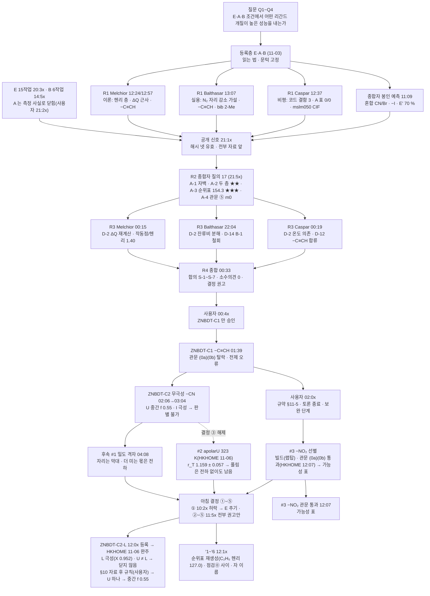
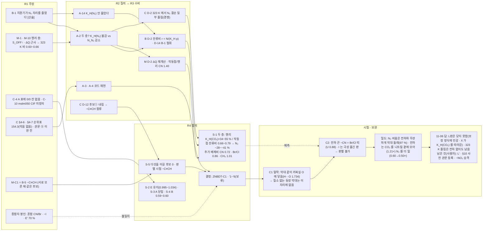

# MAGI-007 사고과정 흐름 — 질문에서 지금까지

두 그림입니다. **절차 흐름**은 누가 언제 무엇을 냈는가(봉인 · 공개 · 질의 · 수비 · 종합 · 시험), **논리 흐름**은 어떤 주장이 어떤 공격을 받아 어떤 합의와 시험으로 이어졌는가. 노드를 누르면 그 노트로 갑니다(링크 목록은 그림 아래). 시각은 [TIMELINE](TIMELINE.md).

## 1. 절차 흐름

## 2. 논리 흐름 — 주장이 어디로 갔는가

## 3. 한 문장씩 — 흐름의 마디

1. **출발**: 다섯 열린 자리 설계(−CN · −Br · −Cl · −CH₃ · −C₂H₅)의 이득이 어디서 오는지 모른 채 "어떤 개질이 더 좋은가" 를 물었다. 세 자리는 각자 한 층만 봤다 — Melchior 는 헨리 층(흡착열), Balthasar 는 자리(공간), Caspar 는 코드와 등록의 결함.
2. **전환점 A-2 / A-14**: 종합자가 원자료에서 "K_H(N₂) 는 줄지 않았는데 혼합에서 N₂ 가 줄었다" 를 짚자, Balthasar 가 B-1 을 철회하고 잔류비로 두 층을 갈랐고, Melchior 는 ΔQ 를 다시 재어 작동점 증폭(CN 1.40배)을 냈고, Caspar 는 323 K 자료로 그 증폭이 온도에 풀리는 경쟁임을 보였다 → **S-1 두 층**.
3. **S-5 → C1**: 세 자리가 서로 모른 채 같은 후보(−C≡CH)로 모였고 종합자는 그 수렴을 근거로 삼았다. 그러나 수렴은 같은 가설(열린 자리 4.101 Å)을 셋이 이어받은 것이었고, CIF 한 번을 열지 않았다. 막대 끝이 카복실 O 에 닿아 **관문 탈락** — "설명이 숫자를 맞히면 의심하라" 의 자리.
4. **C2**: 실제 분자로는 질소 없는 등장 막대가 없으므로 같은 기하에서 전하만 끈 계산 대조로 갔다. 전하를 끄면 −CN 은 Br/Cl 띠로 내려오고, 민감도 판(I)이 극성을 고리로 옮긴 판이 되어 등록 판독은 **판별 불가**로 멈췼다.
5. **밀도 격자**가 그림을 준다: N₂ 가 비는 **자리**는 전하와 상관없이 막대 둘레이고, 전하는 그 자리에 CO₂ 를 모아 N₂ 를 **더** 밀어낸다. U판 "중간 f ≈ 0.5" 와 같은 말이다 — 서술이고, L판이 온 뒤에도 서술로 남았다(마디 7).
6. **C2-L(11-06)**: 빠진 니트릴 전하를 리간드 16 원자에 편 L판은 CO₂ 친화가 U 보다 30 % 올라(K_H(CO₂) 모체비 1.98 대 1.53) X 0.952 로 **극성** 쪽에 섰고, U(중간)와 갈려 등록 판독은 **"전하 끄기 대조는 보정 방식에 민감 — 닫지 않음"** 으로 끝났다. 세 판의 X 가 K_H(CO₂) 순서(U < L < I)를 그대로 따랐다 — 전하를 **어디에 싣느냐**가 CO₂ 친화를 바꾸고 X 는 그것을 따라간다. #2(apolarU 323 K r_T 1.159)는 −CN 의 323 K 풀림이 전하를 꺼도 남음을 보였다. 종합자 예측 다섯은 다 틀렸고, L 정의의 nb 그래프 문턱(1.6 Å)이 C–S(1.74 Å)를 못 담아 티오펜 S 가 빠진 것은 **CIF 를 안 열고 적은 두 번째 전제**였다(결과는 유효). 사용자는 "다른 길" 을 택해 K_H(CO₂) 가 −CN 과 같은 판(U)만 받는 **자료 후 규칙**으로 "중간 f 0.55" 를 얻었다 — 등록 판독 옆에 꼬리표를 달고 붙는 판독이고, 바른 자리는 다음 대조의 사전 관문이다. 서술로 남는 그림 하나: U 는 헨리 층에서 −CN 과 1.5 단위 자로 가를 수 없고 작동점에서 3.35 단위로 갈린다 — **전하의 몫은 작동점 층에서 보인다**(S-1 · 밀도 격자와 같은 말 · HKHOME 보완으로 강도 낮춤).
7. **절차에서 배운 것**: 라운드 중 자리 간 연락·배정은 격리를 깬다(§11-5) · R3 도 봉인해야 한다 · 세 자리 수렴은 독립 확인이 아니다 · 결과 파일은 값이 아니라 표지로 읽는다 · 공용 도구(postman)의 add 단계는 남의 우편함을 되돌릴 수 있다 · 등록문에 거리·그래프 문턱이 들어가면 CIF 에서 잰 값 한 줄을 같이 적는다(C1 · L 두 번) · 자료를 본 뒤 생긴 규칙은 꼬리표를 달고 등록 판독 옆에만 선다(§10).

## 4. 지금 열린 것 (11-07 21:1x 기준 · 6시간 위임 중)

- **−NO₂ 열린 자리 승격**: 관문 셋 통과(S_ON 111 · 물 지수 0.030 = −CN 급 · S_mix 136.5 = −CN 과 0.38 단위) → **E 습윤 6씨앗 등록**(HKHOME s1~3 · laptop2 s4~6 · 11-08 완주 예상). 읽는 법: −CN 140.95 와 1.5 단위 → 공동 1위군 / 위 / 아래 — [ASSIGN_NO2_PLACEMENT §5·§6](../../../ASSIGN_ZNBDT_NO2_PLACEMENT_20261107.md).
- **배치 축**: 겹침 고리판 −Cl · −Br 관문 탈락(#5) + 혼합 실현 a 의 S_mix −3.55 단위 → "열린 고리 배치" 꼬리표 확정. 문헌(치환기 부피 → 상호침투 변화)에 따라 #6 대신 **#5′ 셀 이완 수용 시험**(HKHOME · LAMMPS). 랩탑이 혼합 실현 b(050b) S_mix · 물을 보탬.
- **규약**: §9-11 의 "두 기체 같음" 은 랩탑 ③ 공격으로 **9-11′ 제안**(사용자 확인 대기). §10 꼬리표는 셋(종합자 · laptop2 · 랩탑) 모두 유지.
- **사용자 결정 대기**: 9-11′ 채택 · −NO₂ 의 "열린 고리 배치" 꼬리표를 포스터에 어떻게 · CALF-20 CIF(E-11).
- 닫힌 것: 결정 ①~⑤ · C1 · C2(종결) · #1 · #2 · #3 · #4 관문 · #5.

Related: [TIMELINE](TIMELINE.md) · [EDGES](EDGES.md) · [Synthesizer](seats/Synthesizer.md) · [결정 노드](decisions.md) · [R4 원문](../../MAGI-007_ligand-modification.md) · [INDEX](../INDEX.md)
